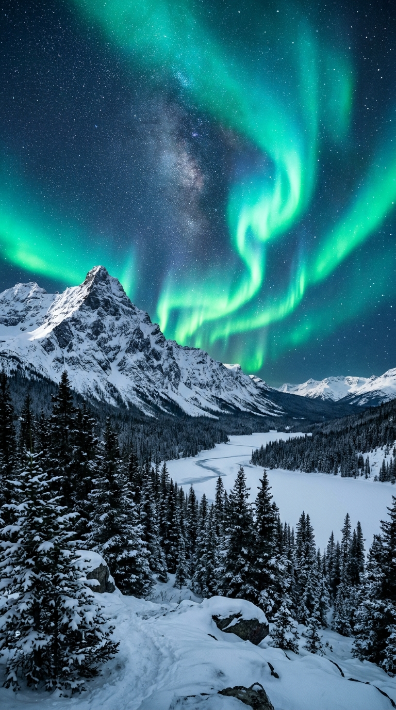
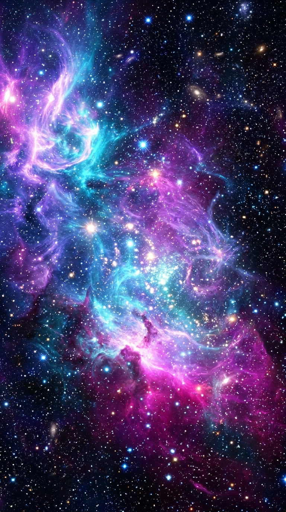
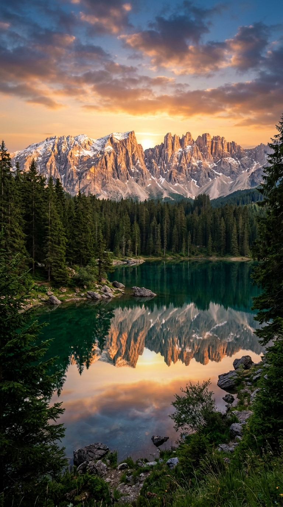
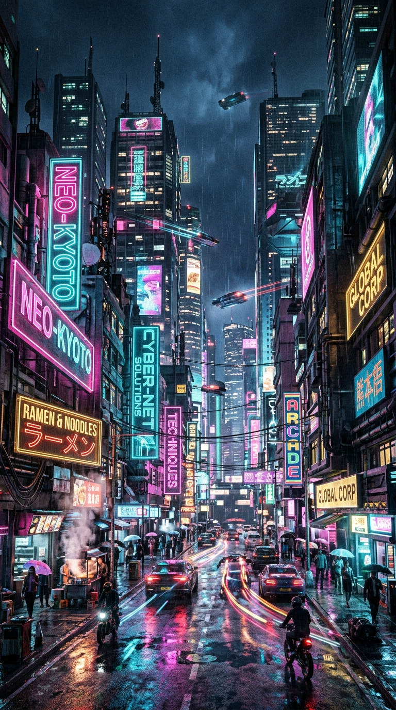

<div align="center">

# 🌐 ChromeX

**مرورگر اندروید مدرن و پرسرعت — ساختار کاملاً شبیه Google Chrome**

Tabs • Incognito • Bookmarks • History • Downloads • RGB Dancing Light • فارسی/عربی/English

</div>

---

## ✨ امکانات (Features)

| امکان | توضیح |
|---|---|
| 🗂️ **چند تب** | تب‌های بی‌نهایت با سوئیچر گرافیکی |
| 🕶️ **حالت ناشناس** | مرور بدون ذخیره تاریخچه |
| 🔍 **نوار آدرس هوشمند (Omnibox)** | جستجو + آدرس یکجا، چند موتور جستجو |
| 🔖 **بوکمارک** | ذخیره و مدیریت سایت‌های موردعلاقه |
| 🕘 **تاریخچه** | کامل با جستجو و پاکسازی |
| 📥 **دانلودها** | مدیریت فایل‌های دانلودی |
| 🖥️ **حالت دسکتاپ** | نمایش نسخه کامپیوتر سایت‌ها |
| 🔎 **Find in Page** | جستجو داخل صفحه |
| 🌈 **RGB Dancing Light** | چراغ رقص رنگی دورتادور صفحه |
| 🎨 **تم‌های رنگی** | Aurora، Galaxy، Nature، Neon + 4 والپیپر |
| 🌍 **سه‌زبانه** | فارسی / عربی / انگلیسی با RTL خودکار |
| 🧹 **پاک‌سازی داده‌ها** | کش، کوکی، تاریخچه با یک کلیک |
| 📱 **Jetpack Compose** | UI مدرن Material 3 |

## 🖼️ تصاویر

| Wallpaper Aurora | Wallpaper Galaxy |
|:---:|:---:|
|  |  |

| Wallpaper Nature | Wallpaper Neon |
|:---:|:---:|
|  |  |

## 📲 دانلود APK

به [بخش Releases](https://github.com/mohmdnini26/ChromeX/releases/latest) بروید و آخرین APK را دانلود کنید.

هر push جدید، **خودکار APK جدید** می‌سازد (GitHub Actions).

## 🛠️ بیلد از سورس

```bash
git clone https://github.com/mohmdnini26/ChromeX.git
cd ChromeX
./gradlew assembleDebug
# خروجی: app/build/outputs/apk/debug/app-debug.apk
```

## 📁 ساختار پروژه

```
app/src/main/java/com/example/
├── MainActivity.kt          # اکتیویتی اصلی
├── model/                   # مدل‌ها (Tab, SearchEngine, ...)
├── viewmodel/               # BrowserViewModel (منطق مرورگر)
├── data/                    # Room database (History, Bookmarks, Downloads)
├── ui/
│   ├── components/          # WebView, Omnibox, TabSwitcher, RGB light ...
│   ├── dialogs/             # Bookmarks, History, Downloads, Settings
│   └── theme/               # تم‌ها و زبان‌ها
```

---
⭐ ساخته‌شده با Compose + Material 3 + WebView
